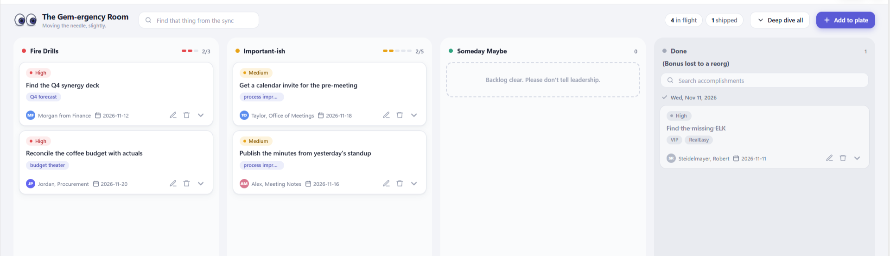

# The Gem-ergency Room

*A tiny task board for the work that is “quick” until it acquires three stakeholders and a steering committee.*

The Gem-ergency Room is a local, drag-and-drop task board. It sorts work into buckets that reflect the modern workplace’s nuanced relationship with urgency:

- **Fire Drills** (High): up to 3 tasks. The cap is a boundary, not a suggestion from leadership.
- **Important-ish** (Medium): up to 5 tasks. A comfortable place for work with a calendar invite.
- **Someday Maybe** (Low): unlimited. Optimism scales horizontally.
- **Done**: completed work, grouped by the date it was moved. The closest thing to a performance review this app provides.

Add a task with a description, stakeholder, soft deadline, and tags. Drag it between buckets, search active and completed work separately, expand cards for details, or double-click a card to edit it. Overdue tasks are marked “Late. Awkward.” Priorities follow the bucket when you move a task. The application runs on Python’s standard library and SQLite; there are no packages to install and no cloud account to align on.

## How to set it up

### Requirements

- Python 3.8 or newer
- A modern web browser

No virtual environment, package manager, or procurement ticket is required.

### Run it

From the project directory, start the server:

```bash
python app.py
```

Then open [http://127.0.0.1:8000](http://127.0.0.1:8000). The server listens on the local machine only. To use another port, set `PORT` before starting it:

```bash
# macOS / Linux
PORT=8080 python app.py

# Windows PowerShell
$env:PORT = "8080"
python app.py
```

Open `http://127.0.0.1:8080` when using the alternate port. Stop the server with `Ctrl+C`; the database will still be there, patiently awaiting the next check-in.

## Sample configuration/setup and screenshots of usage

There is no configuration file to fill out. The only setting is the optional `PORT` environment variable shown above. On first launch, the app creates `tasks.db` beside `app.py`.

### A sample day at the office

1. Start the app and choose **Align** to add a task.
2. Enter **“Get Q4 numbers from Finance”**, description **“Need the final forecast before the deck goes to leadership.”**, stakeholder **“Finance”**, and a due date. Add tags such as `q4` and `forecast`.
3. Put a genuine fire in **Fire Drills**, a likely deliverable in **Important-ish**, or a distant aspiration in **Someday Maybe**. Fire Drills tops out at 3; Important-ish at 5. The app politely suggests descoping when a capped bucket is full.
4. Drag the card as work changes status. Move completed work to **Done**; it will be filed under today’s date, where the win can enjoy appropriate visibility.
5. Search active tasks or Done using their separate search boxes. Search checks task name, description, stakeholder, due date, and tags.

### Screenshots

The screenshot below shows the running board with active tasks, bucket capacity indicators, search, and a dated **Done** item. Expand any card to see its description and full tag list; double-click it to edit.



## Technical notes

- `app.py` serves both the page and a small JSON API using Python’s built-in HTTP server. `index.html` contains the browser interface; `icon.svg` is the app icon.
- Tasks are stored in `tasks.db` (SQLite), created automatically on first run. The database is local and is ignored by Git. Back it up by stopping the app and copying that file; deleting it removes the task data.
- The server binds to `127.0.0.1`, so it is intended for use on the same computer, not as a public or shared network service.
- The High and Medium caps are enforced by the server, including during drag-and-drop. Low and Done have no cap. A task moved back out of Done retains its previous priority only until moved into another active bucket, where priority matches the destination.
- Text fields are trimmed and validated. Names and stakeholder fields allow up to 200 characters; descriptions up to 5,000; due dates use `YYYY-MM-DD`; each task can have up to 10 tags, each up to 30 characters.
- The API routes are `GET /api/tasks`, `POST /api/tasks`, `PUT /api/tasks/<id>`, `DELETE /api/tasks/<id>`, and `POST /api/move`.
- The database initializer adds the tags column to an older database if needed.

## Troubleshooting

- **The page does not open:** confirm the terminal still shows the server running and use the matching port. If port 8000 is occupied, choose another with `PORT`.
- **A task did not move:** check whether the destination’s High or Medium bucket is already at capacity. Some work requires descoping; the database has no executive override.
- **Tasks disappeared:** confirm you are running the same copy of the project. Each copy stores its own `tasks.db` beside its `app.py`.

## License

No license is specified in this repository. Please check with the project owner before redistributing it; even synergy has boundaries.
